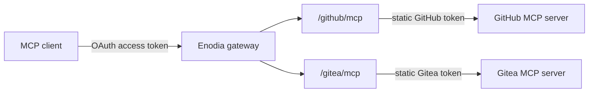

# Enodia


Enodia is an OAuth 2.1 resource-server gateway for [Model Context Protocol](https://modelcontextprotocol.io) servers
that only support a static bearer token. It is named after the Greek goddess of entrances and protection.

Many MCP servers protect their HTTP endpoint with a single shared token. MCP clients such as Claude Code expect OAuth
instead: they
[discover](https://modelcontextprotocol.io/specification/2026-07-28/basic/authorization/authorization-server-discovery)
the authorization server from the protected resource, log the user in, and send short-lived access tokens. This gateway
sits in front of one or more such upstream servers and bridges the two:



It is a small [FastMCP](https://gofastmcp.com) proxy. It does not issue tokens or run a login flow: use an OpenID
Connect provider that issues JWT access tokens (RFC 9068), such as Keycloak, Microsoft Entra ID, Authentik, Pocket ID,
Authelia or Kanidm.

## What it does

- **Serves each upstream at its own path.** In the example, upstream `github` is at `/github/mcp`, with its own protected resource
  metadata, its own upstream token and its own token requirements. A token accepted by one upstream is never accepted
  by another (see [Telling upstreams apart](#telling-upstreams-apart)).

- **Validates access tokens** following RFC 8725 (JWT best current practices) and RFC 9068. A token is accepted only
  if it:
  - is signed by a key in the issuer's JWKS, with the single asymmetric algorithm the gateway accepts;
  - has an accepted `typ` header (`at+jwt` by default);
  - has `iss` exactly equal to the configured issuer;
  - has `exp`, `sub` and an audience the upstream accepts, and is within its validity period (`exp`, `nbf`, `iat`,
    with a configurable clock skew allowance);
  - carries any scopes or claim value the upstream requires.

  Keys are found through the issuer's OpenID Connect discovery document (whose `issuer` must match exactly), cached,
  and refetched when a token names an unknown key ID, so keys can be rotated without a restart. Keys declaring a
  different algorithm, and encryption keys, are ignored.

- **Supports MCP authorization discovery.**
  - Unauthenticated requests get `401` with
    `WWW-Authenticate: Bearer scope="...", resource_metadata="<public URL>/.well-known/oauth-protected-resource/<upstream-name>/mcp"`.
  - It serves that RFC 9728 document, naming the resource, the authorization server and the scopes clients should
    request.

- **Never forwards client credentials.** Upstream requests carry only that upstream's static token. The client's
  access token, cookies and other headers are not passed on.

- **Audits.** It logs one JSON line per MCP request (logger `enodia.audit`) with the upstream, token
  subject, client ID, method, tool name, outcome and duration. The upstream only ever sees the gateway's identity.

- **Refuses unsafe or ambiguous configuration.** It will not start if, among other things:
  - the issuer, public URL or JWKS URL is plain HTTP;
  - the issuer is listed as an accepted audience;
  - a symmetric or `none` algorithm is configured, or the signing algorithm cannot be determined;
  - two upstreams would accept the same tokens;
  - an upstream token file is missing or empty, or the config has unknown keys or an inline token.

## What it does not do

- **Authorization beyond audience, scopes and one claim.** Restrict who can obtain tokens at the identity provider,
  for example by limiting the client to a group.

- **Per-user upstream identity.** Every request reaches an upstream as the same static identity, so give that identity
  only the permissions all gateway users should have.

- **TLS termination.** Run it behind a reverse proxy that terminates TLS.

- **Restricting tools.** Do that in the upstream server's own configuration where it supports it.

- **Reloading configuration.** Restart the container to apply changes. MCP clients re-initialize their session
  automatically.

## Configuration

Policy lives in a TOML file. Runtime settings come from environment variables. Secrets are only ever read from files
named in the config, never written in it.

### Environment variables

| Variable | Default | Description |
| --- | --- | --- |
| `CONFIG_FILE` | `/etc/enodia/config.toml` | Path to the config file |
| `PORT` | `8000` | Listening port |
| `HOST` | `0.0.0.0` | Listening address |
| `LOG_LEVEL` | `INFO` | Python log level |

### Config file

```toml
issuer = "https://id.example.com"       # required; compared exactly with the token's iss claim
public_url = "https://mcp.example.com"  # required; public base URL clients use

[[upstream]]
name = "github"                         # required; path /github/mcp
url = "http://github-mcp:3000/mcp"      # required; upstream Streamable HTTP endpoint
token_file = "/run/secrets/github"      # required; file holding the upstream's static token
resource_name = "GitHub"                # required; shown in the protected resource metadata
```

Top-level settings:

| Key | Default | Description |
| --- | --- | --- |
| `issuer` | (required) | Issuer URL of the OpenID Connect provider, exactly as it appears in `iss` (keep any trailing slash). HTTPS required |
| `public_url` | (required) | Public base URL clients use, without a path for an upstream. HTTPS required |
| `jwks_uri` | from discovery | The issuer's JWKS URL. Normally read from `<issuer>/.well-known/openid-configuration` |
| `algorithm` | from JWKS | The JWT signing algorithm. Normally the `alg` every signing key in the JWKS declares. Asymmetric only |
| `scopes_supported` | `["openid", "offline_access"]` | Scopes clients should request for every upstream (advisory, not enforced) |
| `advertised_scope_prefix` | none | Prefix added to each upstream's `required_scopes` when advertising them to clients, for IdPs whose request form differs from the token form (Entra ID: `"api://<client-id>/"`). Must end with `/`. Tokens are still checked for the unprefixed names |
| `max_clock_skew_seconds` | `60` | Clock skew allowance for `exp`, `nbf` and `iat`, 0–300 |
| `accepted_token_types` | `["at+jwt"]` | Accepted `typ` header values, case-insensitive. Add `"JWT"` for IdPs that do not send `at+jwt` |
| `accept_missing_token_type` | `false` | Accept tokens with no `typ` header |
| `allow_insecure_urls` | `false` | Allow plain-HTTP issuer, public and JWKS URLs. **For local testing only** |

When `accepted_token_types` includes anything other than `at+jwt`, or `accept_missing_token_type` is true, the gateway
can no longer rely on the token type to reject ID tokens. It then refuses tokens carrying `nonce`, `at_hash` or
`c_hash`, or a payload `typ` of `ID`, and requires a non-empty `scope` or `scp` claim.

Per-upstream settings (`[[upstream]]`):

| Key | Default | Description |
| --- | --- | --- |
| `name` | (required) | Lower-case letters, digits and hyphens. The upstream is served at `/<name>/mcp` |
| `url` | (required) | Upstream Streamable HTTP endpoint |
| `token_file` | (required) | File containing the upstream's static bearer token (for example a Docker secret) |
| `resource_name` | (required) | Human-readable name shown in the protected resource metadata |
| `audience` | `["<public_url>/<name>/mcp"]` | Accepted audiences. May be shared with other upstreams |
| `required_scopes` | `[]` | Scopes the token must carry (in `scope` or `scp`). Also advertised to clients |
| `required_claim` | none | `{ name = "groups", value = "mcp-github" }`: the claim must equal the value, or be an array containing it |

The scopes clients are asked to request for an upstream, in its metadata and its `401` challenge, are `scopes_supported`
plus that upstream's `required_scopes`. Each of the `required_scopes` is prefixed with `advertised_scope_prefix` if it
is set. RFC 9728 defines these as the values clients send in authorization requests, which is why the prefix exists:
Entra ID expects `api://<client-id>/github` in the request but puts `github` in the token.

### Telling upstreams apart

Each upstream must accept a distinct set of token claims, or a token obtained for one would work on another. Use one of:

- **A distinct audience per upstream.** This is the default (`<public_url>/<name>/mcp`) and works with identity
  providers that honour the RFC 8707 `resource` parameter MCP clients send. With providers whose audience is the
  OAuth client ID, use one client per upstream and set `audience` to its client ID.

- **A shared audience and a required scope per upstream**, for example one client (or one Entra API) with scopes
  `mcp:github` and `mcp:gitea`.

- **A shared audience and a required claim value per upstream**, for example a group. This also restricts which users
  can use each upstream.

The gateway refuses to start if two upstreams share an audience and neither requires a scope or claim value that
distinguishes it from the other.

## Identity providers

Setup guides, with a config example for each, are in [docs/idp/](docs/idp/README.md):

| Provider | Recommended way to tell upstreams apart | Token type setting | Guide |
| --- | --- | --- | --- |
| Keycloak | Audience (Audience mapper) or scope | `accepted_token_types = ["at+jwt", "JWT"]`, or the client's `at+jwt` option (26.2 or later) | [keycloak.md](docs/idp/keycloak.md) |
| Microsoft Entra ID | Scope per upstream on one API, with `advertised_scope_prefix`; needs a verified domain | Verify (see guide) | [entra-id.md](docs/idp/entra-id.md) |
| Authentik | Scope per upstream on one provider; clients must not send a `nonce` | `accepted_token_types = ["at+jwt", "JWT"]` | [authentik.md](docs/idp/authentik.md) |
| Pocket ID | Audience: one API per upstream (v2.13.0 or later) | None | [pocket-id.md](docs/idp/pocket-id.md) |
| Authelia | Audience (default audiences) or custom scope | None | [authelia.md](docs/idp/authelia.md) |
| Kanidm | Scope per upstream on one client | None | [kanidm.md](docs/idp/kanidm.md) |

## Example (Docker Compose)

```yaml
services:
  gateway:
    # Pin the release you deploy by digest. Find it on the package page on GitHub or with
    # `docker buildx imagetools inspect ghcr.io/richtea/enodia:<version>`.
    image: ghcr.io/richtea/enodia:0.1.0@sha256:bc576cda219ed4d384b8aebcbb91ecf8644407a9d7cab0e7da5e6ddda70234b6
    read_only: true
    cap_drop: [ALL]
    security_opt: [no-new-privileges:true]
    volumes:
      # Mount the directory, not the file, so edits that replace the file are seen after a restart.
      - ./gateway-config:/etc/enodia:ro
    secrets: [github_token, gitea_token]
    networks: [proxy, backend]

  github-mcp:
    image: example/github-mcp
    networks: [backend]   # reachable only from the gateway

  gitea-mcp:
    image: example/gitea-mcp
    networks: [backend]

secrets:
  github_token:
    file: ./secrets/github_token
  gitea_token:
    file: ./secrets/gitea_token
```

With `./gateway-config/config.toml`:

```toml
issuer = "https://id.example.com"
public_url = "https://mcp.example.com"

[[upstream]]
name = "github"
url = "http://github-mcp:3000/mcp"
token_file = "/run/secrets/github_token"
resource_name = "GitHub"

[[upstream]]
name = "gitea"
url = "http://gitea-mcp:8080/mcp"
token_file = "/run/secrets/gitea_token"
resource_name = "Gitea"
```

Clients add one connector per upstream: `https://mcp.example.com/github/mcp` and `https://mcp.example.com/gitea/mcp`.

Put the gateway behind your reverse proxy (TLS, and ideally an IP allowlist and rate limit). Do not buffer responses,
because MCP streams them. The image includes a health check (`--healthcheck`), which passes when every upstream path
answers an unauthenticated request with the expected `401` challenge.

The gateway works out the signing algorithm once at startup. If your identity provider moves to keys of a different
type, restart the gateway.

## Image

- Built by GitHub Actions for `linux/amd64` and `linux/arm64` when a GitHub release is published (see
  [docs/releasing.md](docs/releasing.md)).

- Published to `ghcr.io/richtea/enodia` with build provenance attestations, tagged with the full version (e.g.
  `1.2.3`). Stable releases also update `1.2` and `latest`; prereleases (e.g. `1.3.0-rc.1`) get only their own
  tag.

- Runs as UID 1000 on Python 3.13 slim. The base image is pinned by digest and every Python dependency by hash.

Verify an image's provenance before deploying it:

```sh
gh attestation verify oci://ghcr.io/richtea/enodia:<version> --owner richtea
```

## Development

```sh
uv sync --locked
uv run ruff check .
uv run ty check
uv run pytest
```

CI runs the same three checks. Ruff and ty are configured in `pyproject.toml`.

The tests start a fake identity provider, two token-protected upstream MCP servers and the gateway. They check
discovery, path isolation between upstreams, token validation (each RFC 8725 rule, token types, clock skew, issuer
exactness, scopes and claims, algorithm confusion), key selection, header isolation, auditing, the health check and
configuration validation.

Dependencies are declared in `pyproject.toml` (runtime in `dependencies`, test, lint and type-check tools in the `dev` dependency group) and
locked with hashes in `uv.lock`. To change one, use `uv add <package>==<version>` (or `uv add --dev ...`), or edit
`pyproject.toml` and run `uv lock`. Commit both files.

## Licence

MIT. See [LICENSE](./LICENSE).
